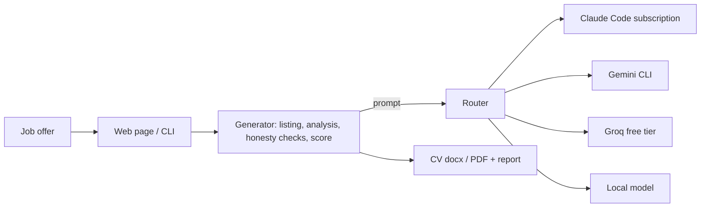

# itsaresume

[](https://github.com/SigSegGit/itsaresume/actions/workflows/ci.yml)

Paste a job offer, get a one-page CV tailored to it and an honest
qualification report, in about two minutes. Every line of the CV comes from
a verified profile; the model selects, the code decides.

Two parts in one repository:

- **The router** (Rust, this directory): sends a prompt to the first backend
  that can answer it, among backends that are **never billed per token** —
  Claude Code on a subscription, Gemini CLI on a Google account, Groq's free
  tier, a local model on an OpenAI-compatible server — and falls back,
  retries an overloaded model, or stops, by rules that are tested.
- **The CV generator** (Node.js, [`cv/`](cv/README.md)): offer in, analysis,
  one-page CV (docx and PDF, ATS-checked) and report out, with a web page
  that also runs as a public site on the author's own server.



## How it is built

- **The model selects, the code decides.** Score, qualification, placement,
  the profile's rules, the injection checks are code, tested; a prompt alone
  never enforces anything. An offer that tells the model what to write is
  read as data, and its instructions are reported, never applied.
- **Tests first, then the code**: the history shows each step as a `red:`
  commit (the failing test) then a `green:` one. More than 900 tests across
  Rust, Node.js and the deploy script.
- **Sabotage testing**: every rule that matters has a defence in
  `scripts/sabotage/` that breaks the code on purpose and checks that the
  named test turns red; a test that stays green is decorative and fixed.
- **Continuous integration** on every pull request, Linux and Windows:
  format, lint (`clippy -D warnings`), tests, sabotage, the testing
  catalogue and the handover kept in step with the code. Merges need it green.
- **Continuous deployment, pull-based**: the server fast-forwards to `main`
  by itself, waits for no CV in progress, backs off after a failed build,
  and never builds a commit that is not on `main`.
- **Built with AI assistants, under these rules**: the assistant writes code
  and tests, the tests, the sabotage and the CI decide what is merged.

"Never billed per token" is enforced, not assumed: no backend has a
credential field, metered variables are removed before `claude` runs, and
tripwires refuse an answer the CLI reports as API-key billed or as extra
usage (overage), then latch so no further request is sent; an overage latch
lifts by itself when the plan's limit resets. The overage tripwire acts
**after** the call that reported it: that one was already billed. Keep
extra usage off on the account; the tripwire is a detector, not a
prevention.

The router produces text and nothing else: it never builds a document.

## Run it

With Docker (the router and the `claude` CLI in one image):

```
cp docker/config.example.toml docker/config.local.toml   # LM Studio URL, model id
cp .env.example .env                                      # CLAUDE_CODE_OAUTH_TOKEN
mkdir -p journal                                          # before Docker creates it root-owned
docker compose up -d
curl -s http://127.0.0.1:8787/v1/complete -H 'Content-Type: application/json' \
     -d '{"prompt": "Write a one-line profile summary for a senior SRE."}'
```

`CLAUDE_CODE_OAUTH_TOKEN` is the subscription token printed by
`claude setup-token` — not an API key. Without it, requests stop with
"Not logged in" (HTTP 502) rather than silently going to another backend: see
[why](docs/ARCHITECTURE.md#error-kinds-and-why-other-never-falls-back-).

Without Docker: `cargo build --release`, copy `config.example.toml` to
`config.local.toml`, then `echo "prompt" | target/release/itsaresume complete`
or `target/release/itsaresume serve`.

A request may name one configured backend (`--backend NAME`, or `"backend"`
in `POST /v1/complete`): only that one is tried, no fallback. It may ask for
structured output (`--schema FILE`, or `"schema"`: a JSON Schema object):
the answer is then a JSON document following it, or the request fails.
A request has a kind (`--kind`, or `"kind"`: `generate` by default, or
`classify`), and a backend may serve only some kinds (`serves` in the
configuration): a small model never gets a generation.
`itsaresume stats` sums the journal up: per backend and outcome, the
fallbacks, the share of structured requests, and the tokens each backend
reported (read, from cache, written), so Claude's and the local model's are
read apart; `stats --by-day` gives the same per UTC day.

The endpoint has no authentication and spends the plan of whoever's token it
holds: it listens on `127.0.0.1` only, in and out of Docker.

Status, plan and design live in [`docs/`](docs/):

| Document | What it answers |
|---|---|
| [ROADMAP.md](docs/ROADMAP.md) | What is done, what is next, in which order |
| [ARCHITECTURE.md](docs/ARCHITECTURE.md) | How a request flows and why a failure falls back or stops |
| [TESTING.md](docs/TESTING.md) | Every test, and the property it proves |
| [HANDOVER.md](docs/HANDOVER.md) | Where to resume work, and the decisions that must not move |

Licence: [AGPL-3.0-or-later](LICENSE).
